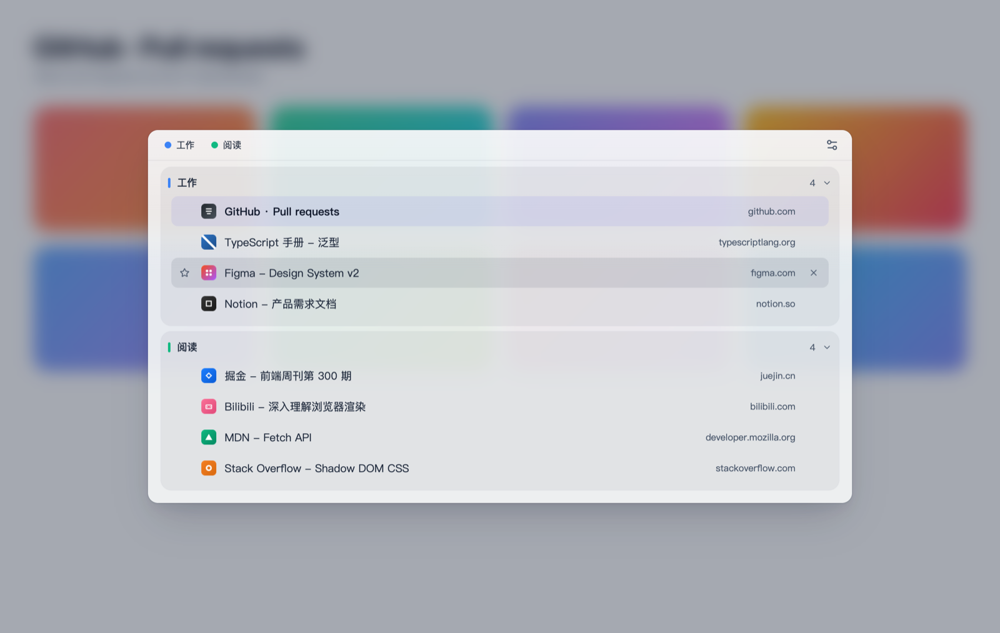
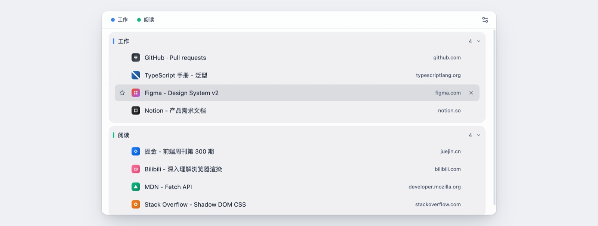
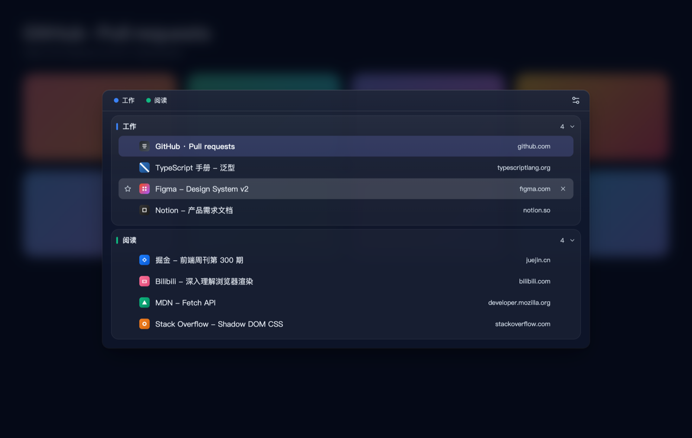

# TabMind

一个 Chrome 扩展：按下快捷键，浏览器正中弹出一块毛玻璃面板，**列出你所有窗口、所有标签组、所有标签页**。点一下就能跳过去。

不联网、不上传、不存标签页数据。



## 为什么需要它

浏览器自带的标签栏是横向的、单窗口的、按打开顺序排的。标签一多，标题就被挤成几个字，只能靠肉眼一个个点，靠记忆猜哪个是哪个。

TabMind 把全部窗口摊开成一张纵向清单，并且**保留你自己建的标签组**——组的颜色、名字、折叠状态都跟着 Chrome 走，不做任何重新组织。你整理好的东西，它照原样呈现。

## 功能

| 功能 | 操作 |
|---|---|
| 打开 / 关闭 | 工具栏图标，或 `Option+Space`（macOS）/ `Alt+Shift+K`（其他）；关闭按 `Esc` 或点面板外 |
| 跳到某个标签 | 点击该行，自动切窗口 + 激活标签 + 关掉面板 |
| 键盘操作 | 打开后直接按 `↑` `↓` 移动高亮，`Enter` 跳转 |
| 标签组 | 组内标签装进独立容器，组头显示颜色、名称、数量，可折叠 |
| 快速定位 | 顶部列出所有标签组，点击滚动到对应组 |
| 收藏 | 悬停行首出现空心星，点击收藏；已收藏显示实心黄星 |
| 关闭标签 | 悬停行尾出现 `×` |
| 多窗口 | 按窗口分组；单窗口时自动隐藏窗口标题 |
| 深色模式 | 跟随系统 / 浅色 / 深色 |

## 两种形态

同一套界面，两种打开方式：

| | 浮层（默认） | 独立页 |
|---|---|---|
| 怎么来 | 在普通网页点图标或按快捷键 | 在 `chrome://`、应用商店这类**禁止注入**的页面点图标 |
| 长什么样 | 页面中央的毛玻璃浮层 | 一个标签页，铺满窗口 |
| 怎么关 | `Esc` 或点面板外 | `Esc` 或点任意标签（这个标签页会自己关掉） |

浏览器不允许任何扩展往 `chrome://` 开头的页面注入脚本。与其只弹一个错误提示，不如换个地方把同样的内容给你看。



## 安装

**Chrome 应用商店**：暂未上架，准备中。

**从源码加载**：

```bash
git clone https://github.com/runtuBro/chrome-tabmind.git
cd chrome-tabmind
npm install && npm run build
```

然后打开 `chrome://extensions` → 右上角开启**开发者模式** → **加载已解压的扩展程序** → 选择 `dist/` 文件夹 → 把图标固定到工具栏。

> 固定到工具栏很重要：不固定的话图标藏在拼图菜单里，快捷键失效或页面不支持时你根本看不到提示。

## 设置

点面板右上角的齿轮进入。

| 设置项 | 选项 | 说明 |
|---|---|---|
| 外观 | 跟随系统 / 浅色 / 深色 | 两套配色独立调过，深色下会加深底色、减弱高光 |
| 语言 | 中文 / English | 即时生效 |
| 面板高度 | 自适应 / 固定 | 自适应按标签数量收缩；固定始终占满 |
| 排序 | 标签栏顺序 / 最近打开 | 「最近打开」在每个窗口、每个标签组**内部**排序，不改变分组结构 |



## 修改快捷键

**Chrome 不允许扩展用代码设置自己的快捷键**，所有扩展都一样，必须去浏览器自带页面改：

1. 面板 → 齿轮 → 点「修改」，自动跳到 `chrome://extensions/shortcuts`
2. 找到 TabMind，点右侧输入框
3. 按下组合键（必须包含 `Ctrl` / `Alt` / `Command` 之一）

设置页会显示快捷键的**实际生效状态**。显示"未设置"说明建议值被系统或其他扩展占了，需要手动指定。

> `Option+Space` 在 macOS 上原本是输入不间断空格（NBSP）的组合键，被占用后在 Chrome 里不再输入 NBSP。介意的话换成 `⌥K` 之类。

## 常见问题

**在 `chrome://extensions` 点图标，为什么打开了一个新标签页？**
那是独立页形态。浏览器禁止扩展注入特权页，所以换了个地方显示同样的内容。

**按了快捷键没反应？**
三种可能：扩展没固定到工具栏（快捷键仍生效，但你看不到任何反馈）；组合键被系统或其他扩展占了（去设置页看是否显示"未设置"）；当前页面是 `chrome://` 或应用商店（会走独立页，不是没反应）。

**面板里为什么没有某个标签？**
面板自己那个标签页不会列出来（否则会出现"点自己跳到自己"）。其余所有标签——包括 `chrome://` 开头的——都会正常显示。

**关掉的标签能恢复吗？**
目前不能，面板里没有撤销。误关可以用 Chrome 自带的 `Ctrl/Cmd + Shift + T` 恢复最近关闭的标签。

**数据会传到服务器吗？**
不会。代码里没有任何网络请求，标签页和书签信息不离开这台设备。

## 隐私与权限

| 权限 | 为什么需要 |
|---|---|
| `tabs` | 读取标签页标题、网址、访问时间，执行跳转和关闭 |
| `windows` | 跨窗口激活与聚焦 |
| `favicon` | 稳定获取站点图标（不受页面 CSP 限制） |
| `scripting` + `activeTab` | 点击图标时往**当前这一个页面**注入面板 |
| `tabGroups` | 读取标签组的名称、颜色、折叠状态。**只读，不会改你的分组** |
| `storage` | 记住你的设置。不存标签页数据 |
| `bookmarks` | 判断标签是否已收藏、创建或删除书签。只在你点星标时写入 |

**没有 `host_permissions`，也没有常驻的 `content_scripts`。**

这意味着 Chrome 的权限提示是「仅在您点击扩展程序时访问当前页面」，而不是「读取和更改您在所有网站上的数据」。页面加载时扩展什么都不做，只有你真的点了图标，才往那一个页面注入面板。

## 已知限制

| 限制 | 原因 |
|---|---|
| `chrome://`、应用商店、PDF 查看器里没有浮层 | 浏览器禁止注入特权页，改为打开独立页 |
| `file://` 页面需要手动开启「允许访问文件网址」 | Chrome 默认安全策略 |
| 快捷键必须在 `chrome://extensions/shortcuts` 里改 | 扩展无法用代码设置自己的快捷键 |
| 面板长时间无操作后可能短暂停止更新 | MV3 会回收后台脚本，重连后自动补一份最新数据，通常感知不到 |

## 开发

构建命令、目录结构、实现原理见 [DEVELOPMENT.md](DEVELOPMENT.md)。

技术栈：Manifest V3 · TypeScript · Vite · React 18 · Tailwind CSS 3 · Zustand
